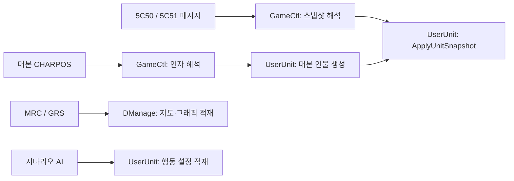

# Ghidra MCP 연결과 원작 바이너리 구조 정리

2026-11-01. REA 6.8.0 MCP와 Ghidra 12.1.4를 연결하고 후기 원본 5개 바이너리의 시나리오 파일 읽기·유닛 생성·AI 경로를 정리했다. 원본 EXE/DLL 바이트와 Unity 실행 코드는 수정하지 않았다. 이 결과는 선택한 핵심 함수의 분석이며 전체 게임 소스 복원 완료를 뜻하지 않는다.

## 결과물

| 대상 | 정리한 함수 | 주요 범위 |
| --- | ---: | --- |
| UserUnit.dll | 7 | 유닛 스냅샷 적용, 대본 인물 생성, 위치 갱신, AI 적재/활성/역할 분기 |
| GameCtl.dll | 7 | 수신 디스패치,5C50/51 해석,CHARPOS,시나리오 안내/이벤트 읽기 |
| setunit.dll | 5 | 타일·능력치·아이템·마법 공용 표 적재 |
| DManage.dll | 4 | MRC/GRS 적재,지도 교체,타일/장식 디코드,화면 스프라이트 캐시 |
| Saver.exe | 5 | AI/EVT 추출,메시지 전달,저장된 개체 레코드의 인물 생성 경로 |

- `projects/DarkSaverOriginal.gpr`와 `projects/DarkSaverOriginal.rep/`: **실제 Ghidra 프로젝트**. 두 항목을 함께 보관하고 Ghidra의 File → Open Project에서 연다. `.gpr`는 빈 프로젝트 표시 파일일 수 있으며 데이터베이스는 `.rep` 안에 있다.
- `typed/{대상}/{함수명}.c`: 구조체·함수명을 적용한 디컴파일 코드. 원본 소스나 바로 빌드 가능한 게임 클라이언트가 아니다.
- `refactor-plan.json`: 주소, 분석자가 부여한 이름/주석, 원본 해시, 엔트리32바이트와 파일 오프셋. 이름 자체와 원작에 실제 존재한 식별자를 구별한다.
- `{대상}/before-*.c`, `after-*.json`, `annotation-*.json`: 실제 MCP 호출의 변경 전후 코드와 완전한 Evidence. 현재 코드와 Evidence ID 매핑은 `refactor-check.json`을 따른다.
- `{대상}/evidence-bundle*.json`: 세션을 닫기 전에 내보낸 근거 묶음. `verified.json`의 `evidenceBundle`이 있으면 그 묶음이 최종 검토본이다.
- `NativeUnitLayout.h`: 확인된 필드만 이름 붙이고 나머지 바이트는 보존한32비트 부분 레이아웃.
- `unit-layout-check.json`, `project-verification/`, `refactor-check.json`: 실제 검증 결과.

먼저 읽을 코드:

1. `typed/UserUnit/ApplyUnitSnapshot.c`
2. `typed/GameCtl/DecodeUnitSnapshot_5C50.c`, `DecodeUnitSnapshot_5C51.c`
3. `typed/UserUnit/SpawnActorFromScriptArguments.c`
4. `typed/DManage/LoadMapResourcesAndGeometry.c`

## 확인한 구조



`NativeUnitInfo32`의 크기는0xB0이며 개체번호+0x00,병종+0x04,타일X/Y+0x48/+0x4C다. 런타임 `NativeCharacter32` 간격은0x2E0이고 개체번호+0x10,병종+0x18,타일X/Y+0x70/+0x74다. UserUnit 프로젝트에는 원본 런타임 배열 포인터 `0x1010B3A0`의 부분 자료형도 적용했다. 확인하지 못한 필드를 임의의 능력치 이름으로 채우지 않았다.

`DManage::StartPosAndValidSpriteInit`는 뷰 캐시 좌표4개를-100으로 초기화하고 장식 개수×4바이트의 인덱스 버퍼를 할당한다. 초기 몬스터 배치 함수로 취급하지 않는다. `setunit`의 `0x10001420`은ability/ability1, `0x10001A10`은itemtbl/itemtbl1, `0x10001ED0`은magictbl/magicptn/solskill을 읽는다.

## MCP와 저장 프로젝트의 구분

26개 함수는 실제 MCP `annotate_native_function`으로 이름·주석을 변경하고 디컴파일 결과를 다시 받았다. Saver의 `0x4419C0`, `0x42A9A0` 두 함수는 MCP의 자동 포함 함수 조회가 찾지 못했다. 원본의 SEH 프롤로그와 엔트리 바이트를 확인한 뒤 별도 프로젝트에서 디스어셈블/함수 경계를 복구했고, 필수 호출 지점 `0x441B0A`, `0x42AA7C`가 각 함수 본문에 포함되는지 검사했다. 이2개를 MCP가 복구했다고 보고하지 않는다.

REA는 분석 메타데이터 변경 후 스냅샷 내보내기를 `evidence_integrity_mismatch`로 제한한다. 해당 제한을 우회하지 않았다. MCP 결과는 Evidence와 재적용 계획으로 보존하고, **별도의 Ghidra headless 프로젝트**에 같은 근거를 적용해 실제 데이터베이스를 저장했다. `.base-snapshot`은 REA 관찰/프로필 기록이며 `.gpr/.rep` 프로젝트의 대체물이 아니다. UserUnit의 최초 거부 응답은 `snapshot-export-rejected.json`에 남겼다.

## 설치와 검증

- Ghidra 공식 ZIP: `ghidra_12.1.4_PUBLIC_20260921.zip`, 공개 SHA256 `ddac49f903da9d5bac833e5cc79395098b9c33cfd3279be5f31bd00387d2d4db` 대조.
- 전체 JDK: Temurin21.0.13+9. REA용 Node24.22.1과 함께 `/workspace/.tools`에 보관했다.
- Codex `mcp_servers.rea.env`에 `GHIDRA_INSTALL_DIR`, `JAVA_HOME`을 추가하고 기존 등록과 설정을 보존했다. `readiness.json`의 선택된 Ghidra 검사와 실제 MCP 디컴파일을 확인했다.
- 프로젝트를 다시 열어5개 프로그램의28개 함수명,엔트리32바이트,부분 구조체와 포인터 자료형을 검사했다. 원본5파일은 전체 SHA256이 그대로다.
- C11 `sizeof/offsetof` 검사와 원본 x86 수신/복사 경로의 시험 메시지6건을 대조했다. CString·할당·기존 경로 해제는 모델이며 실제 Windows 원작/Unity Play를 실행한 결과는 아니다.

검사 명령:

```bash
PYTHONDONTWRITEBYTECODE=1 PYTHONPATH=/workspace/.tools/ds-ghidra-python python Tools/GhidraChecks/check_unit_layout.py
python Tools/GhidraChecks/check_refactor_results.py
```

`Tools/GhidraChecks/rea_mcp.py`는 Codex 설정의 REA 서버와 실제 stdio MCP로 연결하는 로컬 전달기다. 분석 세션을 유지하면서 요청/응답을 파일로 보존한다. 원격 대상이나 원본 게임을 자동 실행하지 않는다. `refactor_native.py`는 검토된 계획의 수집/메타데이터 적용을 담당하고, `ApplyDarkSaverRefactor.java`·`VerifyDarkSaverProject.java`는 별도 저장 프로젝트의 생성·재열기 검사를 담당한다.

이번 정리로01~25의 전체 초기 몬스터 편성·좌표를 새로 확보한 것은 아니다. 수신 구조·대본 생성·지도 그래픽·AI 설정을 구분할 수 있게 만든 것이며, 미확정 배치나 서버 운영 규칙을 생성하지 않았다.
