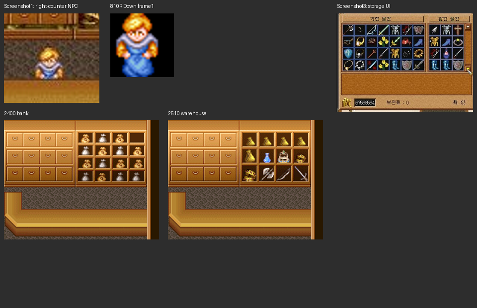

> 후속 근거(2026-10-26, `3c82cad4`): `ffeawf2.jpg`에서 창고 왼쪽807 Down 후보, `잇힝.png`에서 은행 간판·오른쪽810 Down 후보 및 입출금 UI를 확인했다. 아래의 ‘은행 직원 미확인’은 이전 사진 범위의 기록이다. 서로 다른 창고 사진의 좌/우 직원을 동시2명으로 확정하지 않는다. [추가33개 대조](전체_스크린샷_분석대조.md)의 최신 절과 `added_reference_npc_matches.json`을 따른다.

# 은행·창고 스크린샷 재대조

사용자 제공 원작 참고 이미지 `닥세_리소스/ĸó1.jpg`, `ĸó3.jpg`, `ĸó4.jpg`를 추가 대조했다. 이전 스크린샷 갤러리의2장과 별개로 저장소 루트 자료에 있던 화면이다. 게임 실행/Unity Play 검증이 아니다.

|항목|이번에 확인한 내용|판정 한계|
|---|---|---|
|실내|2510 창고의 오른쪽 금괴·물약·무기 진열대와 강한 일치|2400 은행 진열대는 주머니/금화 그림으로 다름. 간판은 UI에 가려짐|
|NPC|`ĸó1.jpg` 오른쪽 카운터 뒤 금발·흰 목깃·파란 옷 인물은 원본810R 하향 중앙 프레임과 강한 일치|810은 외형/표의 마을사람 ID. 화면에 실제 NPC 이름/서버 인스턴스 ID가 표시된 것은 아님|
|NPC 수|직원으로 보이는 인물 최소1명 관찰|다른 영역이 창에 가려져 전체 직원 수를1명으로 확정하지 않음|
|배치|이미지 프레임 좌상단은 원본 환산 약480,128px, 타일15,4 부근|스프라이트 좌상단 위치이며 게임 논리 좌표/Unity 피벗·발 위치는 별도임|
|물건 보관 UI|`ĸó3.jpg`는 가진 물건/보관 대상 목록, 스크롤, 금액, ‘보관료:0’, 확인 표시|보관/반환의 실제 요청 순서·최대 보관 수·저장 단위는 화면만으로 확정 불가|
|원본 UI 자료|`Wlib/scene20.lsc`,419×303의 ‘가진 물건/맡길 물건’ 바탕과 스크롤40/39·확인19 존재|스크린샷의 정확한 클라이언트 버전과 모든 동작의 동일성은 미확인|
|은행|이 화면들로 은행2400 직원은 식별하지 못함|창고 근거를 은행에 그대로 적용하지 않음|

`ĸó4.jpg`는 중문 UI의 유사한 보관 화면이다. 요금0이 보인다는 이유로 항상 무료였다고 확정하지 않는다. 보이는 플레이어/가문 이름을 창고 직원 이름으로 옮기지 않는다. 금액 표시가 있는 것만으로 금전 입출금 기능까지 확정하지 않는다.

## 대조 방법

`ĸó1.jpg`의 노출된 오른쪽 진열대73×42px 영역을 원본 실내의 배율/위치 후보와 대조했다.2510은 배율0.9/이동2,3에서 RGB 평균제곱오차534.71,2400은 각자 최적 맞춤에서도3517.93이다. 원본 도형 구성의 육안 대조와 같은 방향의 결과다.

NPC의 하단은 카운터에 가려지므로 불투명한 상단22행만 사용해804~828 마을사람의 하향3프레임을 대조했다.810 중앙 프레임이905.71로 가장 낮았다. 이는 JPEG·배율·가림을 포함한 후보 순위이며 확률/통계적 신뢰도가 아니다.

- 수치·파일 해시·후보 목록: `storage_analysis.json`
- 원본 보관 UI 정적 그림: `Wlib_scene20.png` (아이템/요금/금액을 합성하지 않음)
- 비교용 일반 상점 UI: `Wlib_scene10.png`
- 재현: `PYTHONPATH=/tmp/ds-late-deps python 닥세_리소스/분석도구/analyze_storage_screenshots.py` (Pillow/NumPy 설치 경로에 맞춰 PYTHONPATH 조정)

## 현재 구현과의 차이

현재2510에는 임의 선택했던 외형827을 `(9,6)`에 배치했다. 이번 자료는 해당 화면의 창고 직원 외형을810으로 바꿀 강한 근거가 된다. 은행2400의807은 이 자료로 확인된 것이 아니다. 사진만으로 입출금·보관료·용량·계정 공유 규칙을 새로 정하지 않았다. 이번 작업은 분석 자료 갱신이며 런타임 NPC/경제 코드는 변경하지 않았다.
